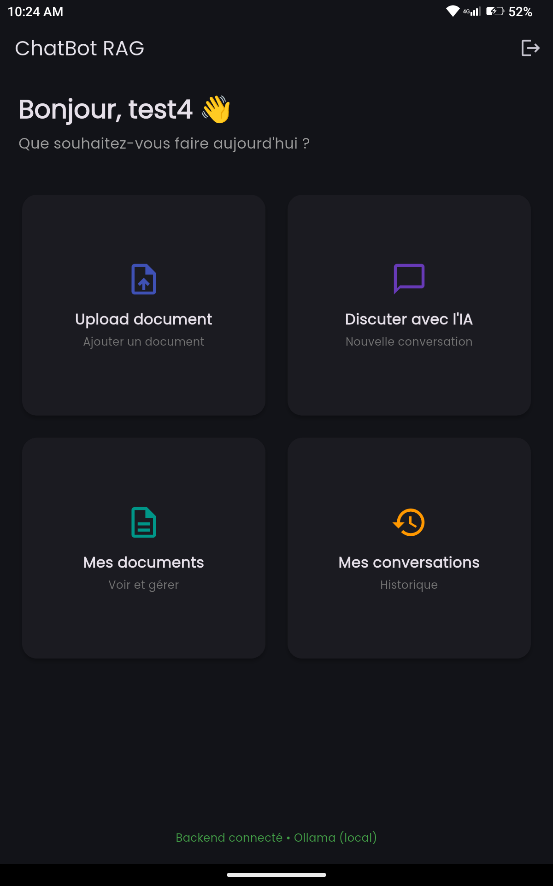
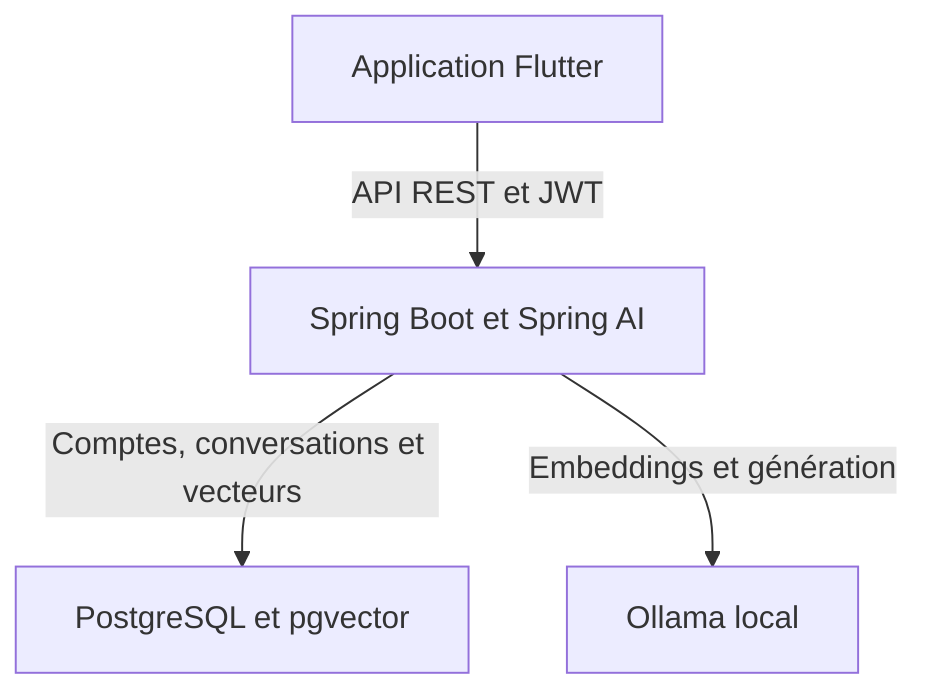
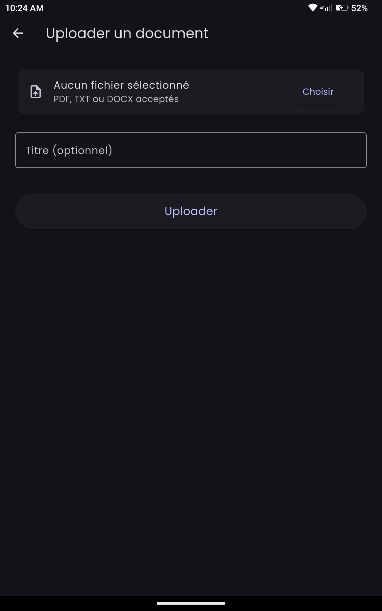
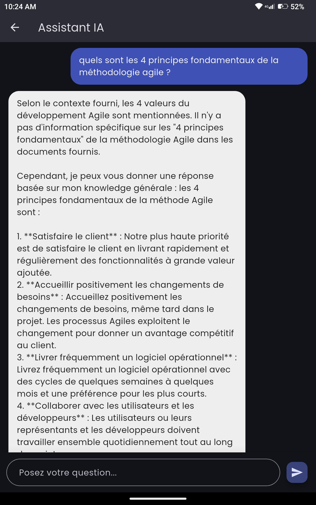
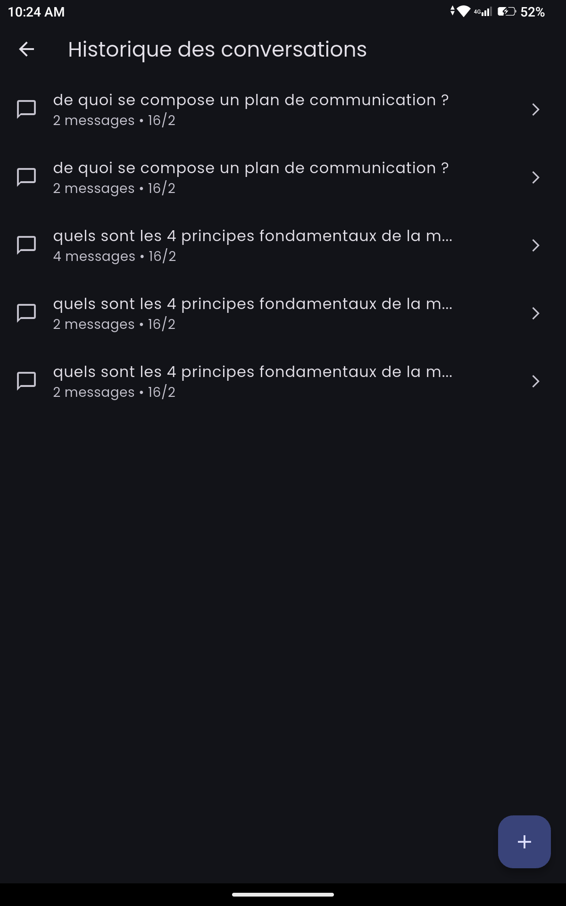

# ChatBotRAG

[](https://github.com/abdel-saw/ChatBotRAG/actions/workflows/backend-tests.yml)

**Un assistant documentaire avec Flutter, Spring AI et Ollama.**

Importez vos documents, posez une question et retrouvez vos conversations.
Le backend extrait le texte, le découpe, stocke ses embeddings dans PostgreSQL
avec pgvector, puis recherche le contexte associé à l'utilisateur connecté.

*English summary: a Flutter document assistant backed by Java/Spring Boot,
Spring AI, PostgreSQL/pgvector and local Ollama inference.*



## Fonctionnalités implémentées

- Import et extraction de documents avec Apache Tika.
- Recherche vectorielle filtrée par utilisateur et réponse avec contexte.
- Authentification JWT et historique des conversations.
- Suppression des documents et de leurs entrées dans le vector store.
- Interface Flutter avec Riverpod, GoRouter et Dio.

Les téléchargements initiaux des images, dépendances et modèles nécessitent
Internet. La génération et les embeddings utilisent ensuite l'instance locale
d'Ollama. Le backend ne requiert pas de clé d'API de fournisseur LLM.

## Architecture



Le backend utilise Java 21 et Spring Boot 3.5.10. Les modèles configurés par
défaut sont **llama3.2:3b** pour les réponses et **mxbai-embed-large** pour les
embeddings de 1024 dimensions. L'inférence peut tourner sur CPU, avec une
latence dépendant du matériel.

## Démarrage local avec Docker

Prérequis : Git, Python 3, Docker avec Compose v2 et Flutter compatible avec
Dart 3.11 pour le client. Prévoir l'espace disque et la mémoire nécessaires
aux images et aux modèles Ollama.

### Cloner et générer la configuration

```bash
git clone https://github.com/abdel-saw/ChatBotRAG.git
cd ChatBotRAG/chatbotrag-backend
python scripts/setup_local.py
```

Le script crée un fichier `.env` local avec un mot de passe PostgreSQL et une
clé JWT aléatoires. Il n'affiche pas ces valeurs et ne remplace jamais un fichier
existant. Sous Windows, utiliser `py` à la place de `python` si nécessaire.

Le fichier `.env.example` décrit les variables ; ses champs de secrets sont
volontairement vides. Un démarrage Compose sans ces valeurs échoue avec un
message de configuration.

### Démarrer les dépendances et charger les modèles

```bash
docker compose up -d --wait db ollama
docker compose exec ollama ollama pull llama3.2:3b
docker compose exec ollama ollama pull mxbai-embed-large
docker compose up -d --build backend
docker compose ps
```

Les commandes de téléchargement correspondent aux modèles par défaut.
Si leurs noms changent dans `.env`, télécharger les mêmes noms dans Ollama.
Le backend attend les contrôles de disponibilité de PostgreSQL et d'Ollama ;
la disponibilité du serveur Ollama ne garantit pas que les modèles ont été
téléchargés.

### Lancer le client Flutter

Depuis `chatbotrag-backend` :

```bash
cd ../chatbotrag
flutter pub get
flutter run --dart-define=API_BASE_URL=http://10.0.2.2:8080
```

| Cible du client | API_BASE_URL |
| --- | --- |
| Émulateur Android | `http://10.0.2.2:8080` |
| Simulateur iOS ou application de bureau sur le même ordinateur | `http://localhost:8080` |
| Téléphone sur le réseau local | `http://ADRESSE_IP_DU_PC:8080` |

Pour un téléphone physique, définir `BACKEND_BIND_ADDRESS=0.0.0.0` dans `.env`,
recréer le backend avec `docker compose up -d backend` et vérifier le pare-feu
local. Par défaut, les ports publiés sont accessibles uniquement depuis
l'ordinateur hôte. Le manifeste Android de debug autorise l'HTTP local ;
cela ne configure pas un déploiement de production.

## Configuration et persistance

| Variable | Usage |
| --- | --- |
| `DB_PASSWORD` | Mot de passe PostgreSQL local, requis par Compose |
| `JWT_SECRET` | Clé de signature JWT, au moins 32 octets UTF-8 |
| `OLLAMA_CHAT_MODEL` | Modèle de génération, défaut : `llama3.2:3b` |
| `OLLAMA_EMBEDDING_MODEL` | Modèle d'embeddings, défaut : `mxbai-embed-large` |
| `BACKEND_BIND_ADDRESS` | Adresse de publication de l'API, défaut : `127.0.0.1` |

Compose conserve PostgreSQL, les modèles Ollama et les fichiers importés dans
trois volumes distincts. `docker compose down` arrête les conteneurs en
conservant ces volumes. L'option `--volumes` supprime les données locales.

**Installation existante :** conserver le mot de passe correspondant au rôle
PostgreSQL de votre volume. Changer uniquement `DB_PASSWORD` ne modifie pas le
mot de passe d'une base déjà initialisée. Le fichier de configuration auparavant
suivi par Git est retiré de la version courante, pas de l'historique.
Pour une base existante, préparer sa configuration locale avant la mise à jour.
Changer `JWT_SECRET` invalide les sessions existantes : se reconnecter ensuite.

Pour lancer Java hors de Docker, exporter les variables dans le processus :
Spring Boot ne lit pas automatiquement le fichier `.env` de Compose.
`DB_URL`, `DB_USER`, `DB_PASSWORD`, `JWT_SECRET` et `OLLAMA_BASE_URL`
permettent alors d'utiliser les services locaux. L'URL PostgreSQL par défaut
est `jdbc:postgresql://localhost:5432/chatbotrag`.

Changer le modèle d'embeddings pour une dimension différente demande une
adaptation du schéma vectoriel et une réindexation ; modifier son nom seul
ne suffit pas.

## Vérification

Les commandes et le périmètre des tests sont décrits dans
[docs/BACKEND_TESTING.md](docs/BACKEND_TESTING.md).

```bash
# Depuis chatbotrag-backend
python -m unittest discover -s scripts -p "test_*.py" -v
bash mvnw -B -Dtest=DocumentServiceTest,ChatServiceTest,PgVectorDocumentDeletionTest,JwtUtilTest test
```

Sous Windows, remplacer `bash mvnw` par `./mvnw.cmd`.
La CI vérifie aussi la construction Docker et l'inscription/authentification
sur la pile complète, sans télécharger de modèles ni générer de réponse IA.
Ce contrôle de démarrage ne valide pas une conversation de bout en bout :
les deux modèles doivent être disponibles pour cela.

## Essayer le parcours complet

1. Créer un compte dans l'application Flutter.
2. Importer un court document de test, puis poser une question dont la réponse
   est présente dans ce document.
3. Vérifier l'historique et l'isolement entre deux comptes.
4. Supprimer le document et vérifier que ses extraits ne sont plus récupérés.
   Les messages déjà enregistrés dans l'historique ne sont pas effacés par cette
   suppression.

## Captures





## Limites actuelles

Prototype académique. Les migrations de schéma restent gérées par
`ddl-auto: update`, et les suppressions fichier/base ne constituent pas une
transaction atomique. L'authentification et les filtres utilisateur ne remplacent
pas un audit complet d'isolation. Le client et le parcours avec les modèles
locaux nécessitent une vérification sur les appareils ciblés.

L'hébergement du backend, de PostgreSQL et des modèles Ollama nécessite plus
de ressources qu'un simple site statique. Une démo publique sur hébergement
gratuit sera préparée séparément ; aucun lien de démo active n'est annoncé ici.

## Auteur

SAWADOGO S Abdel · FST Settat, Université Hassan 1er.

